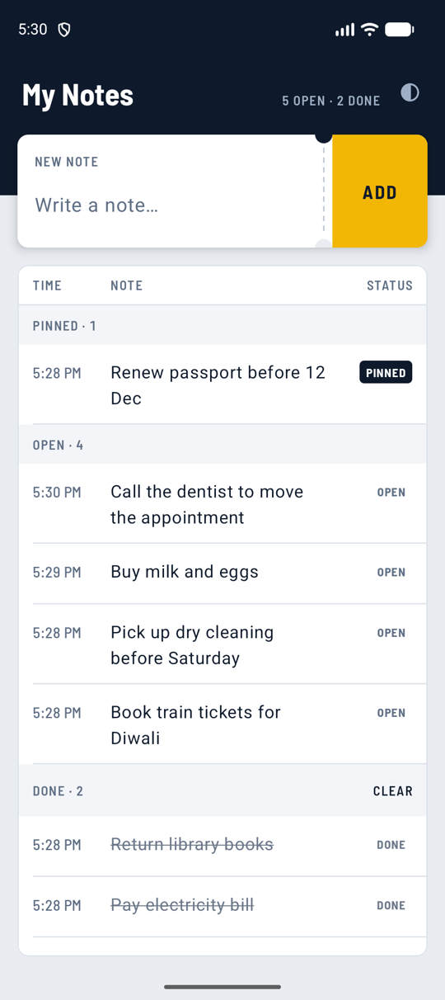
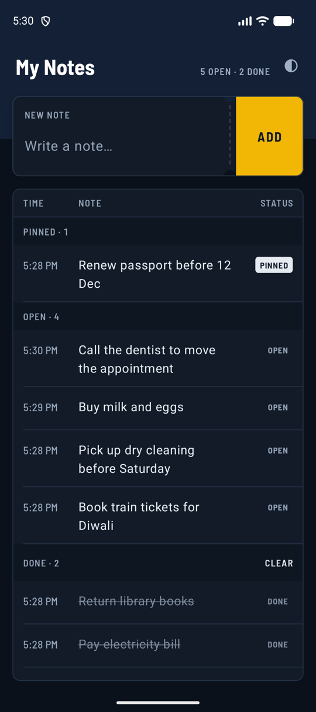
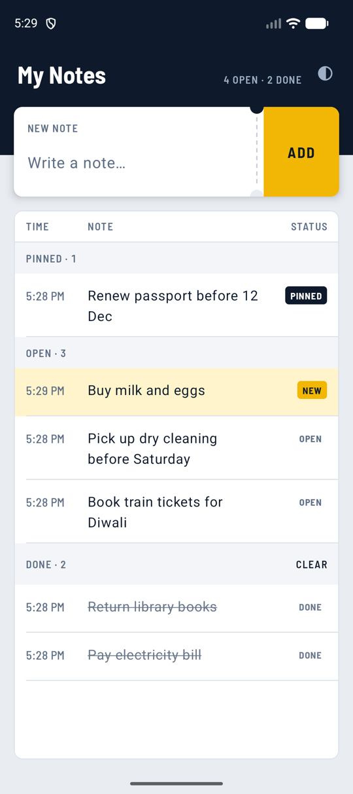
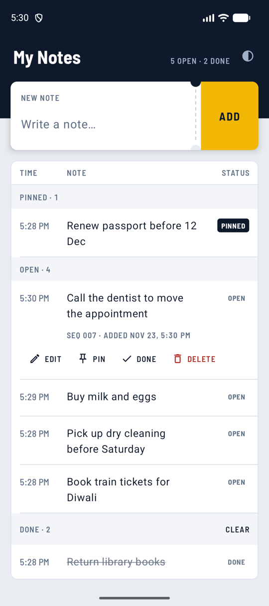
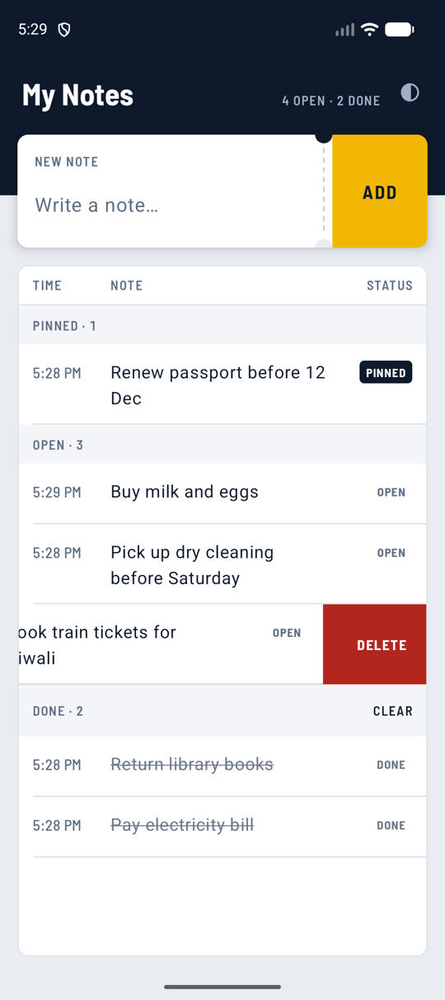
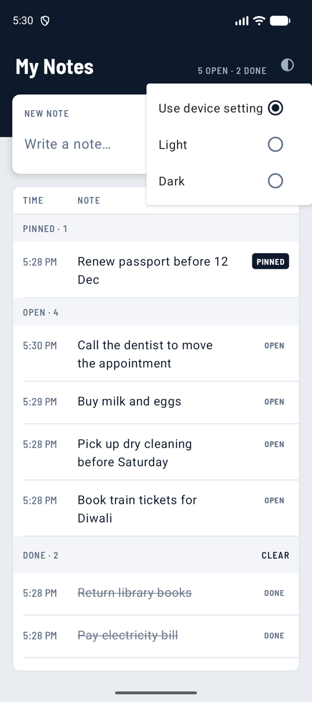
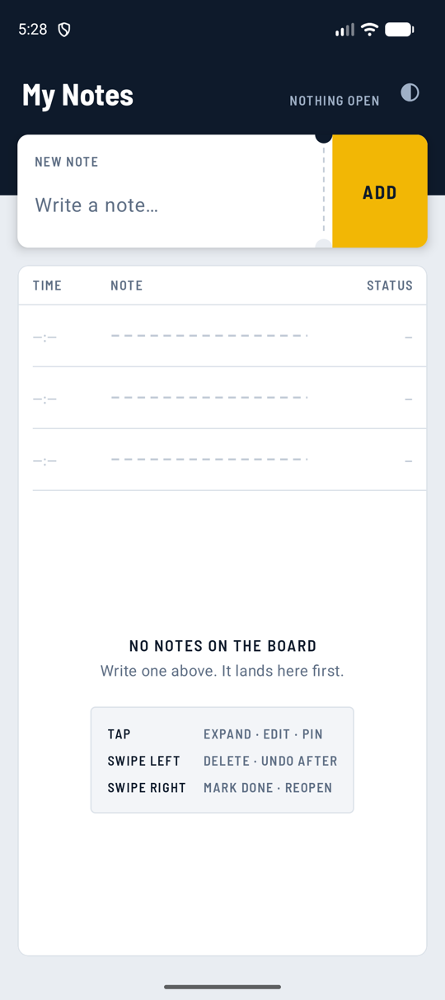

# My Notes

A fast, private note board for Android. Jot down tasks, events and deadlines in seconds, then see what's still open at a glance. It is designed like a departure gate board: the add box is a boarding pass at the top, and your notes sit on a board below in TIME · NOTE · STATUS columns.

Everything stays on your device. There are no accounts, no sync and no network access.

<p align="center">
  
  &nbsp;
  
  &nbsp;
  
</p>

## Features

- **Add from the top.** Type into the boarding pass and tap **ADD**, or press the keyboard's ✓ key. The new note lands first on the board, lit amber with a **NEW** tag.
- **Pinned, Open and Done sections.** Notes are newest first, and pinned notes stay above the rest.
- **Tap a note to expand it.** You see the full text and when it was added, plus **Edit**, **Pin**, **Done** and **Delete**.
- **Swipe gestures:**
  - Swipe left to delete, with **Undo**.
  - Swipe right to mark a note done, or to reopen it.
- **Edit in place.** The note loads back into the pass (EDITING · SEQ 007) with **SAVE** and **CANCEL**.
- **Clear done notes** in one tap, with **Undo**.
- **Light and dark themes.** Use the switch in the header to choose *Use device setting*, *Light* or *Dark*. The choice is remembered.
- **Motion that shows what changed:**
  - Rows slide to their new place instead of blinking.
  - Status tags flip like a split-flap departure board.
  - Changes light up amber and then fade.
  - Respects Android's *Remove animations* setting.
- **Readable at any size.** Supports large system font sizes and edge-to-edge screens.

<p align="center">
  
  &nbsp;
  
  &nbsp;
  
</p>

<p align="center">
  
  <br />
  <sub>The empty board shows the gestures before you add your first note.</sub>
</p>

## Tech stack

- Kotlin, Android Views with View Binding, Material 3
- MVVM: `ViewModel` + `LiveData`
- Room database (v2, with a migration from v1 that keeps existing notes)
- `RecyclerView` with `ListAdapter`/`DiffUtil`, `ItemTouchHelper` for swipes and a custom item animator
- AndroidX SplashScreen
- Barlow Semi Condensed font (SIL Open Font License), bundled in `res/font`

## Build and run

Requirements: Android Studio (recent), JDK 17 or newer (Android Studio's bundled JDK works), Android SDK 34.

```bash
./gradlew assembleDebug
```

Or open the project in Android Studio and run the **app** configuration on a device or emulator (Android 6.0 / API 23 or newer).

## Project structure

```
app/src/main/java/com/notes/manishsubah/
├── data/            Room database, DAO, migration, repository
├── domain/model/    Note entity
└── presentation/
    ├── adapter/     Board adapter (sections, rows, status tags)
    ├── ui/          MainActivity, swipe handling, motion, theme preference
    └── viewmodel/   NoteViewModel
```

Design notes live in [`PRODUCT.md`](PRODUCT.md) (what the app is for) and [`DESIGN.md`](DESIGN.md) (colours, type, layout and motion).
